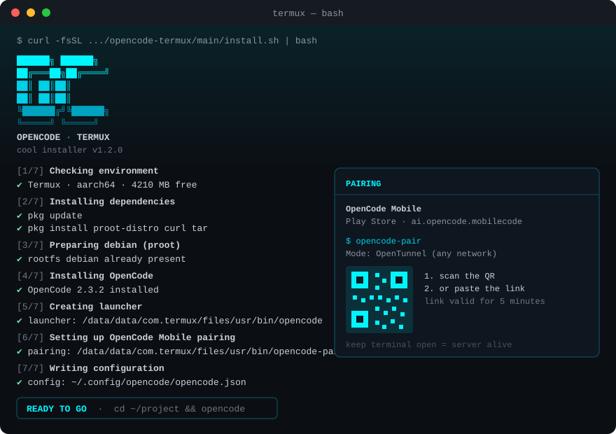

<div align="center">



# OpenCode × Termux

**Pasang OpenCode V2 di Termux — satu baris, tanpa ribet.**
Plus pairing langsung ke **OpenCode Mobile** di Play Store.

[](install.sh)
[](#kebutuhan)
[](https://opencode.ai)
[](LICENSE)

</div>

---

## Pasang

```bash
curl -fsSL https://raw.githubusercontent.com/JackRipper-ID/opencode-termux/main/install.sh | bash
```

Langsung sekalian pairing ke HP:

```bash
curl -fsSL https://raw.githubusercontent.com/JackRipper-ID/opencode-termux/main/install.sh | bash -s -- --pair
```

Installer akan menampilkan progress, menyembunyikan log panjang, dan berhenti dengan pesan jelas kalau ada langkah yang gagal.

---

## Apa yang dilakukan

| # | Langkah | Keterangan |
|---|---|---|
| 1 | Cek lingkungan | Pastikan Termux, aarch64, dan ruang kosong ±1.5 GB |
| 2 | Pasang dependensi | `proot-distro`, `curl`, `tar` |
| 3 | Siapkan Debian | rootfs proot + `apt update` |
| 4 | Pasang OpenCode | Installer **resmi** `opencode.ai/v2/install` di dalam Debian |
| 5 | Launcher | `opencode` → otomatis bind folder project ke `/workspace` |
| 6 | Pairing | `opencode-pair` → QR + link untuk OpenCode Mobile |
| 7 | Config | `~/.config/opencode/opencode.json` (dipakai bareng host & proot) |

Tidak ada binary yang di-repack. Yang dipasang adalah build resmi OpenCode untuk `linux-arm64`, dijalankan lewat proot karena OpenCode belum merilis build Android native.

---

## Pakai

### TUI di Termux

```bash
cd ~/project
opencode
```

Folder tempat kamu menjalankan `opencode` otomatis di-bind ke `/workspace` di dalam proot, jadi agent melihat project kamu — bukan root filesystem Termux.

### OpenCode Mobile (Play Store)

1. Pasang **OpenCode** dari Play Store — paket `ai.opencode.mobilecode`.
2. Di Termux, jalankan:

   ```bash
   opencode-pair
   ```

   Muncul QR + link sekali pakai (berlaku 5 menit).
3. Scan QR atau tempel link di aplikasi. Sesi di Termux langsung muncul di HP.

Mau lewat Wi-Fi yang sama saja (tanpa tunnel)?

```bash
opencode-pair --local
```

> Biarkan terminal `opencode-pair` tetap terbuka selama HP terhubung — server berjalan di dalam proot dan ikut mati kalau sesi ditutup.

### Biar Android tidak mematikan server

```bash
termux-wake-lock
```

---

## Kebutuhan

- Termux dari [F-Droid](https://f-droid.org/packages/com.termux/) atau [GitHub releases](https://github.com/termux/termux-app/releases) — **bukan** versi Play Store yang sudah usang
- Android **aarch64 / ARM64**
- Ruang kosong ±1.5 GB
- Koneksi internet

Cek arsitektur:

```bash
uname -m   # harus aarch64
```

---

## Opsi installer

```text
-h, --help             tampilkan bantuan
-v, --version <ver>    pasang versi OpenCode tertentu
    --distro <name>    distro proot (default: debian)
    --pair             langsung jalankan pairing setelah install
    --uninstall        hapus launcher + distro
    --no-color         tanpa warna
    --dry-run          hanya cek lingkungan
```

Contoh:

```bash
# versi tertentu
bash install.sh --version 2.0.6

# cek dulu tanpa mengubah apa pun
bash install.sh --dry-run

# distro lain
bash install.sh --distro ubuntu
```

---

## Uninstall

```bash
curl -fsSL https://raw.githubusercontent.com/JackRipper-ID/opencode-termux/main/uninstall.sh | bash
```

Yang dihapus: launcher `opencode`, `opencode-pair`, dan rootfs proot. Config di `~/.config/opencode` sengaja dibiarkan.

---

## Troubleshooting

| Gejala | Solusi |
|---|---|
| `This script must be run in Termux` | Jalankan di Termux, bukan di proot/SSH |
| `Unsupported architecture` | Perangkat harus ARM64 (`uname -m` → `aarch64`) |
| Installer berhenti di langkah tertentu | Log lengkap path-nya dicetak di akhir output |
| QR kedaluwarsa | Link berlaku 5 menit — jalankan `opencode-pair` lagi |
| HP tidak bisa connect | Pastikan terminal pairing masih terbuka, coba `opencode-pair --local` di Wi-Fi yang sama |
| Server mati saat layar off | `termux-wake-lock`, dan matikan optimasi baterai untuk Termux |
| `proot-distro` error saat install | `pkg update && pkg install --reinstall proot-distro` |

---

## Struktur

```text
opencode-termux/
├── install.sh      # installer + pairing
├── uninstall.sh    # pembersih
├── preview.svg     # banner README
└── LICENSE
```

---

<div align="center">
<sub>Dibuat untuk Termux. OpenCode adalah proyek open source — repo ini hanya installer.</sub>
</div>
